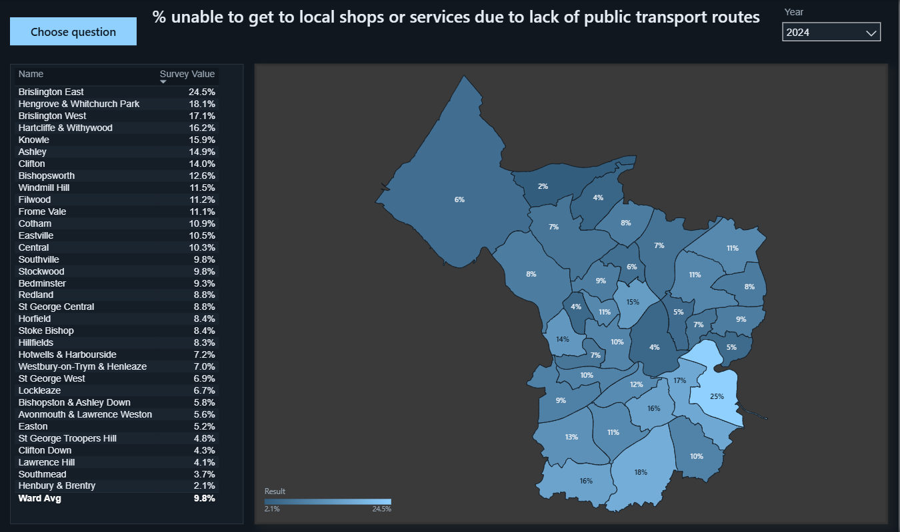

# Case studies

A growing collection of small data and analytics projects, mostly built with Power BI, Microsoft Fabric, DAX, SQL and Python. Each project lives in its own folder with its own README, data notes and screenshots.

| Project | What it is | Tools |
|---------|------------|-------|
| [Bristol Quality of Life](bristol-quality-of-life/) | Interactive ward map and ranked table for Bristol City Council's Quality of Life survey. Pick any of 294 questions. | Power BI (PBIP/PBIR), DAX, Deneb (Vega-Lite) |

## Notes

- Data licences and attributions are listed in each project's README. Source data that cannot be redistributed is not committed; each project explains where to get it.
- Projects are saved in Power BI's text-based PBIP format, so the model and report definitions can be read and compared in Git.
