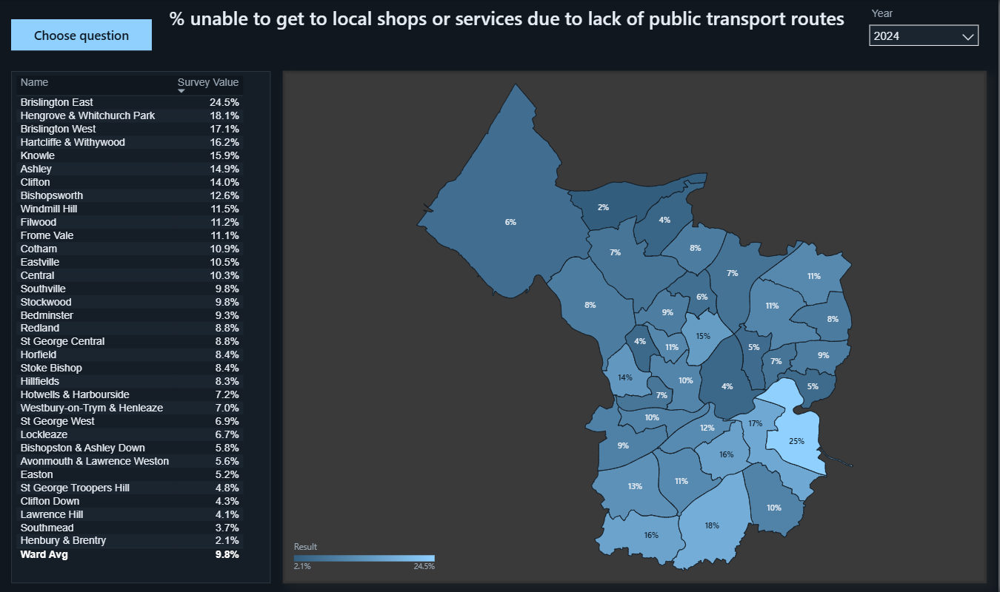
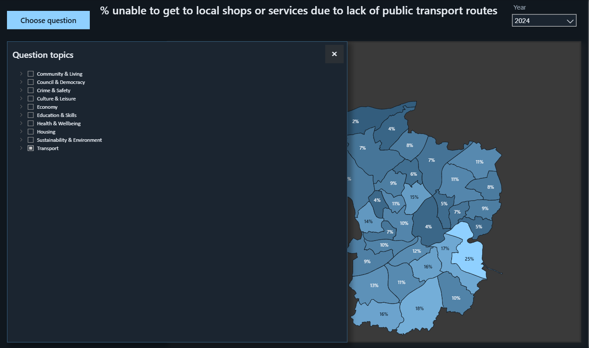

# Bristol Quality of Life: ward map in Power BI

An interactive Power BI report page that maps Bristol City Council's Quality of Life survey results by ward. Pick any of the 294 survey questions and the map, ranked table and title all update.

## What it does

- **Choropleth ward map** built with Deneb (Vega-Lite) and embedded TopoJSON ward boundaries. Each ward is shaded by the survey result and labelled with its percentage.
- **Ranked ward table** with a "Ward Avg" total row. Selecting a row cross-filters the map, which helps people who don't know where a ward is.
- **Question picker**: a flyout panel with a theme > question hierarchy slicer.
- **Year dropdown** and a **title that shows the selected question**.
- **Tooltip** showing the ward result, the Bristol average, the difference in percentage points (▲/▼) and whether the ward is better or worse than Bristol.

## Open it

1. Download or clone this repo.
2. Get the survey data (see **Data** below) and save it in the `data` folder.
3. Open `Bristol Quality of Life.pbip` in Power BI Desktop (April 2024 or later, with the PBIP/PBIR preview features enabled).
4. Open **Transform data > Edit parameters** and set `DataFolder` to the full path of the `data` folder, for example `C:\github\case-studies\bristol-quality-of-life\data`.
5. Click **Refresh**. On first open you will see two banners (refresh external data sources, and visuals with no data). That is expected, because the repo ships without cached data.

## Data

- **Quality of Life survey 2024/25**, Bristol City Council, published on [Open Data Bristol](https://opendata.bristol.gov.uk/). Download the ward-level Quality of Life dataset and save it as `data/Bristol_Quality_of_Life_data_(2024_25).csv`. It is not included here, so please check its licence on the portal.
- **Ward codes and names**: `data/bristol_wards.csv`, based on ONS ward geography. Contains public sector information licensed under the [Open Government Licence v3.0](https://www.nationalarchives.gov.uk/doc/open-government-licence/version/3/).
- **Ward boundaries** embedded in the map: derived from ONS / Ordnance Survey open boundary data. Contains OS data © Crown copyright and database right, and ONS data © Crown copyright.

## How it was built

The report layer was built with Claude Code and the semantic model edited with the Power BI Modeling MCP, working in the PBIP/PBIR text format. See [docs/how-this-was-built.md](docs/how-this-was-built.md) for the method, the lessons learned and the problems along the way.

## Repo layout

- `Bristol Quality of Life.Report/`: report definition (PBIR)
- `Bristol Quality of Life.SemanticModel/`: semantic model (TMDL)
- `data/`: ward lookup and the place to put the survey CSV
- `docs/`: screenshots and build notes
